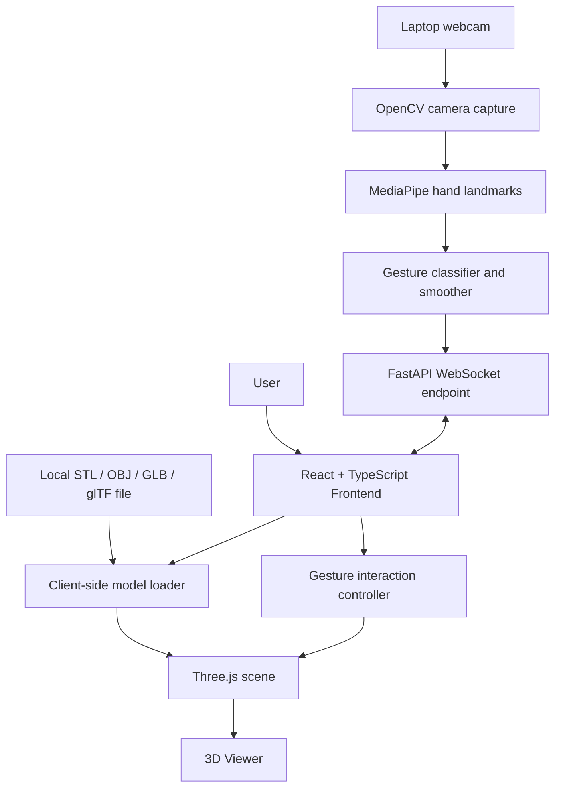

# ARCHITECTURE.md — System Design

## 1. High-level design

The application is split into a browser frontend and a local Python gesture service. Three-dimensional rendering remains in the browser; camera processing remains in Python. They communicate through a versioned WebSocket protocol.



## 2. Runtime boundaries

### Browser frontend

Responsibilities:

- Present the upload control, viewer, gesture controls, and connection/tracking status.
- Load model files locally using Three.js loaders.
- Create and manage the Three.js scene, camera, lighting, model bounds, and render loop.
- Connect to the local WebSocket service.
- Translate protocol events into camera/orbit/zoom/pan operations.
- Preserve mouse/touch interaction as a fallback.
- Release resources and subscriptions when components unmount or files change.

The frontend must not depend on Python implementation details beyond the documented WebSocket contract.

### Python service

Responsibilities:

- Open the local webcam using OpenCV.
- Run hand-landmark inference using MediaPipe.
- Track hand position and finger landmarks over time.
- Derive gesture state, normalized movement deltas, and pinch scale changes.
- Smooth noisy input and apply confidence/dead-zone thresholds.
- Publish status and gesture events over WebSocket.
- Validate client commands and clean up the camera when the service stops.

The Python service does not render the 3D model, persist uploaded assets, or need access to the model file.

## 3. Suggested repository layout

```text
gesture-3d-viewer/
├── AGENTS.md
├── PROJECT.md
├── ARCHITECTURE.md
├── TASKS.md
├── TESTING.md
├── API.md
├── frontend/
│   ├── src/
│   │   ├── components/
│   │   │   ├── ModelViewer.tsx
│   │   │   ├── ModelUploader.tsx
│   │   │   ├── GestureStatus.tsx
│   │   │   └── ViewerToolbar.tsx
│   │   ├── hooks/
│   │   │   └── useGestureSocket.ts
│   │   ├── services/
│   │   │   └── gestureController.ts
│   │   ├── types/
│   │   │   └── gestureProtocol.ts
│   │   └── App.tsx
│   └── package.json
└── backend/
    ├── app/
    │   ├── main.py
    │   ├── camera.py
    │   ├── hand_tracker.py
    │   ├── gesture_classifier.py
    │   ├── gesture_processor.py
    │   └── websocket_manager.py
    ├── tests/
    └── requirements.txt
```

This is a recommended starting layout, not a mandate to create empty files. Adjust names to fit the implementation, but keep module responsibilities separate.

## 4. Main data flows

### Model loading

1. The user selects a local model file in the frontend.
2. The frontend checks the extension and basic file validity.
3. The appropriate Three.js loader loads the selected file in the browser.
4. The viewer computes bounds, centers the model, chooses an initial fit-to-view distance, and adds it to the scene.
5. On replacement or removal, dispose of old GPU resources and revoke any object URLs that were created.

Use `STLLoader` for STL, `OBJLoader` for OBJ, and `GLTFLoader` for both `.gltf` and `.glb`. External resources referenced by a glTF file may need to be selected or loaded through a supported asset-pack strategy; a standalone GLB is generally simpler for a first version.

### Gesture capture and control

1. Python opens the webcam and captures frames locally.
2. Frames are passed to the hand-landmark detector.
3. The gesture classifier uses landmarks and prior tracking state to detect gestures and calculate motion deltas.
4. The processor applies smoothing, confidence thresholds, and dead zones.
5. The WebSocket endpoint sends status events and gesture events as JSON.
6. The frontend validates incoming events and hands them to the gesture interaction controller.
7. The controller converts deltas into bounded camera/orbit/zoom/pan changes.
8. The normal Three.js render loop renders the updated scene.

## 5. Gesture and coordinate model

- Landmark coordinates from the hand tracker are typically normalized to the image dimensions. Convert these to a stable, documented normalized coordinate system before use.
- For screen-relative positions, use `x` and `y` in the range `[0, 1]`; document whether the x-axis is mirrored to match the user's view. Choose one behavior and test it.
- Use per-frame deltas for rotation/pan, rather than making the viewer jump to absolute camera coordinates.
- For pinch zoom, derive a scale ratio from current pinch distance relative to the previous valid distance. Clamp extreme ratios and reset the baseline after tracking loss.
- Apply a minimum confidence threshold and small movement dead zone. Smooth positions/deltas to reduce jitter, but avoid heavy smoothing that makes controls feel delayed.
- Require stable gesture detection across a small number of frames or a short time window to reduce accidental activation.
- On tracking loss, emit a `gesture` event with `phase: "end"` for any active gesture, then status `tracking: "lost"` as defined in `API.md`.

## 6. WebSocket design

- Local development URL: `ws://127.0.0.1:8000/ws/gestures`.
- The frontend is the client; the Python service is the server.
- Use JSON text messages and protocol version `1`.
- Protocol messages and event fields are specified in `API.md`.
- Send compact events; never send raw video frames over the gesture WebSocket.
- Support clean disconnects, malformed messages, camera errors, and reconnecting clients.
- MVP assumption: one active gesture client at a time because a camera is a shared hardware resource. A second connection should be rejected with a clear protocol error or should replace the first connection according to one explicitly tested policy. Default policy: reject the second active client.

## 7. Concurrency and resource lifecycle

- Do not run an endless camera read/inference loop directly on the asyncio event loop.
- Keep one camera/inference producer and publish the latest state to the active WebSocket client. A worker thread or another clearly bounded worker approach is suitable for synchronous OpenCV/inference calls.
- Prefer latest-state delivery over an unbounded queue. Old gesture events are not useful if a client is slow; bounded queues prevent memory growth and latency accumulation.
- Close the WebSocket, stop the worker, release the camera, and reset tracking state during shutdown or unrecoverable camera errors.
- Avoid opening a new camera capture for every incoming WebSocket message.

## 8. Error handling

| Condition | Expected behavior |
|---|---|
| No model selected | Show a helpful empty state. |
| Unsupported/corrupt model | Show a user-readable error and keep the app usable. |
| Model is unusually large | Show loading progress where possible and handle failure without breaking the page. |
| Camera cannot open | Send an error/status event; retain normal mouse/touch viewer control. |
| No hand detected | Report `tracking: "searching"` or `"lost"`; do not invent movement. |
| Tracking is temporarily lost | End the active gesture and reset delta baselines. |
| WebSocket disconnects | Show disconnected status and retry with bounded backoff. |
| Unknown protocol message | Return a documented error or ignore only where `API.md` permits it. |
| Second active client | Reject with a clear error under the MVP policy. |

## 9. Security and privacy

- The local Python service binds to loopback (`127.0.0.1`) by default.
- Check the browser `Origin` against explicitly configured development origins during the WebSocket handshake.
- Do not assume loopback binding alone is a complete security boundary; browser-to-localhost interactions can still have security implications.
- Do not enable public-network access or remote camera processing by default.
- Do not save video frames or transmit them to analytics/third parties.
- When packaging for a remote-hosted frontend, revisit mixed-content restrictions, secure WebSockets, origin checks, authentication, and browser private-network access behavior before release.

## 10. Observability

Log service startup/shutdown, camera state transitions, WebSocket connect/disconnect, protocol errors, and inference failures. Avoid logging raw landmarks at high frequency, images, or unnecessary user data. Expose a small status payload to the frontend instead of relying on console logs.

## 11. Performance targets

Initial targets, to be measured and tuned on the target laptop:

- Gesture-event cadence: approximately 20–30 updates per second when tracking is stable.
- Avoid unbounded event queues and stale movement events.
- Smooth the interaction without making it feel delayed.
- Preserve interactive rendering for typical model sizes; test large files separately and document practical limits.

These are engineering targets, not verified results. Profile on representative hardware before claiming performance.
